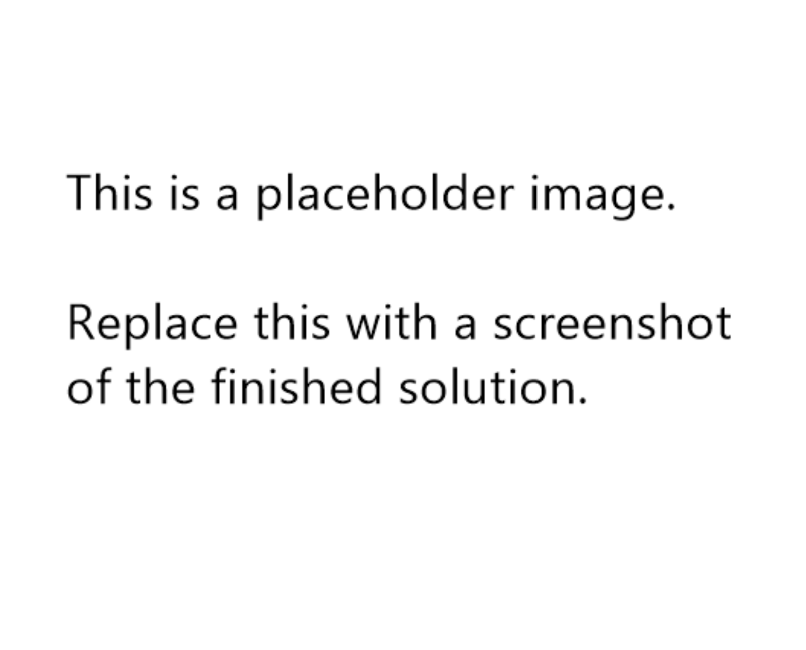

# Frontend Mentor - Recipe page solution

This is a solution to the [Recipe page challenge on Frontend Mentor](https://www.frontendmentor.io/challenges/recipe-page-KiTsR8QQKm). Frontend Mentor challenges help you improve your coding skills by building realistic projects.

## Table of contents

- [Overview](#overview)
  - [The challenge](#the-challenge)
  - [Screenshot](#screenshot)
  - [Links](#links)
- [My process](#my-process)
  - [Built with](#built-with)
  - [What I learned](#what-i-learned)
  - [Continued development](#continued-development)
  - [Useful resources](#useful-resources)
- [Author](#author)
- [Acknowledgments](#acknowledgments)

## Overview

### The challenge

The challenge is to build out this recipe page and get it looking as close to the design as possible.

Any tools can be used to help complete the challenge. Practicing something new is fair game, feel free to give it a go.

### Screenshot



### Links

- Solution URL: [github repo (this page)](https://github.com/ElwinBeall/FEM_recipe-page)
- Live Site URL: [github.io site](https://elwinbeall.github.io/FEM_recipe-page/)

## My process

### Built with

- Semantic HTML5 markup
- CSS custom properties
- Flexbox
- CSS Grid
- Mobile-first workflow

### What I learned

In the last couple solutions, I found that the repetition in CSS selectors can get cumbersome, especially when dealing with child selectors and media queries. I researched child selectors and discovered the **&** nesting selector. As it turns out, you can simply nest elements, classes, and ids directly in a declaration block without having to resort to SASS.

Although not very meaningful, the below snippet gets the point across:

```css
.card {
  display: grid;
  .container {
        background-color: gray;
        img {
            border-radius: 10%;
        }
    }
}
```

### Continued development

I continue to read through language references for several languages, libraries, and frameworks. I had to step away from Frontend Mentor for a few months, but it's keeping me busy with CSS again. I intend on continuing with other learning paths to improve my retention of the material here.

I continue to try to use Git from the command line when creating repos, setting the origin, and pushing initial commits. I'll get more invovled with adding files for commits once I have the basics down. I've used Git with Visual Studio and am versed on PRs (pull requests) and reverts if something goes wrong. I think learning the command line will help in understanding Git's intricacies.

### Useful resources

I still think these are useful resources:

- [FreeCodeCamp.org](https://www.freecodecamp.org) - I like to browse articles here sometimes. With so many learners creating articles, you're bound to learn from someone else's insights. They also have a nice Web Development curriculum.
- [Github Markdown Emoji Reference](https://msemjan.github.io/en/posts/emoji/) - This is not really an essential reference, but it does help keep interest up in learning Markdown. I'm familiar with the basics, but keeping it fun will help. :smile:

## Author

- Website - [Elwin Beall](https://www.your-site.com)
- Frontend Mentor - [@Elwin Beall](https://www.frontendmentor.io/profile/ElwinBeall)

## Acknowledgments

Thanks to everyone who has reviewed profiles, lent a hand, or just liked ❤️ a completed challenge.
